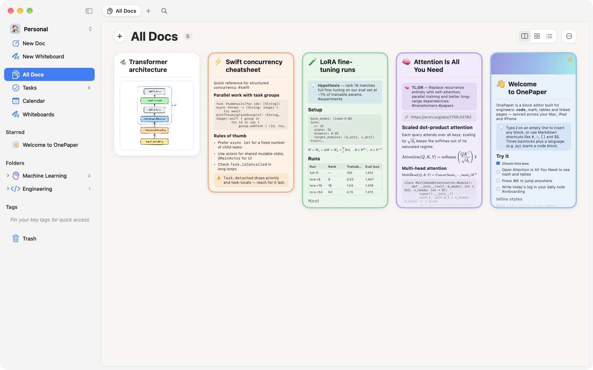
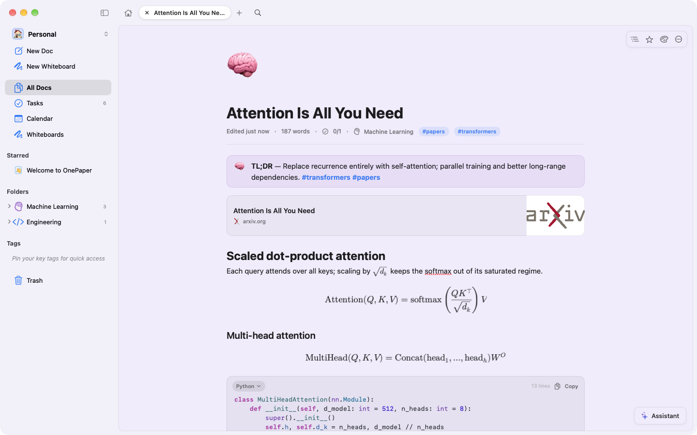
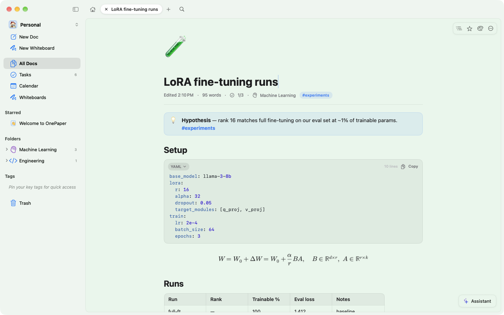
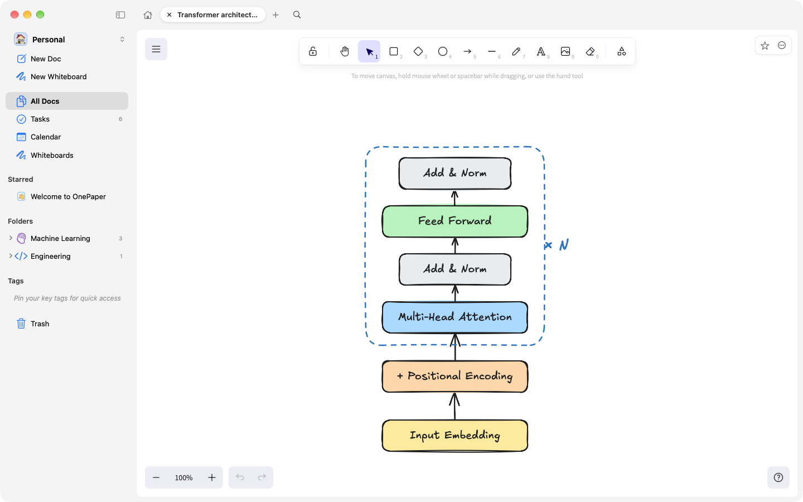
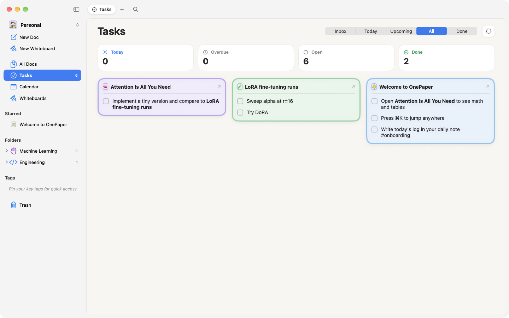
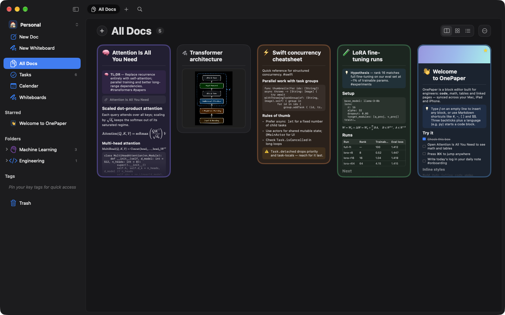
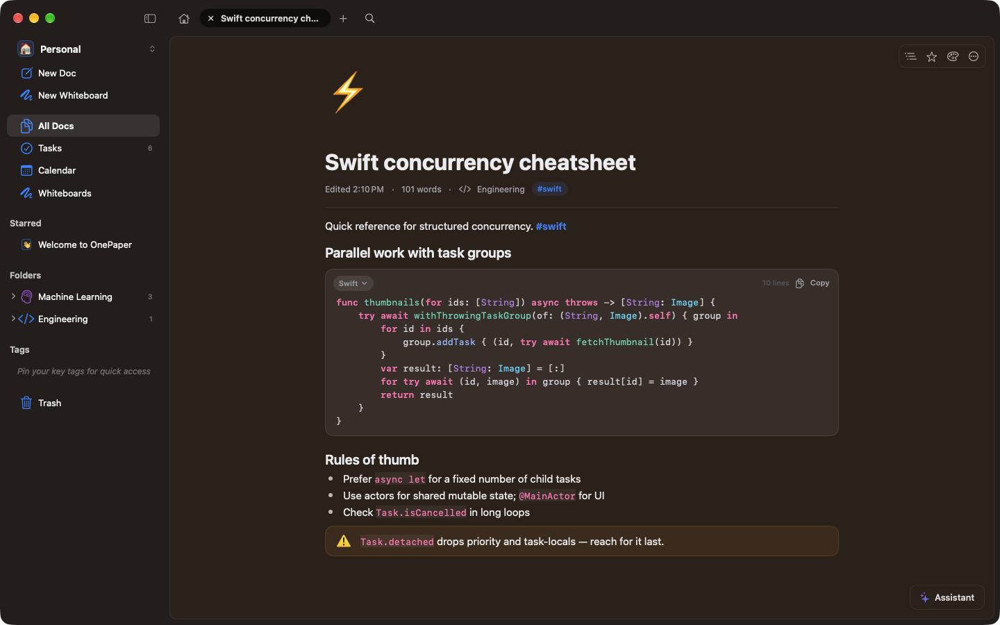
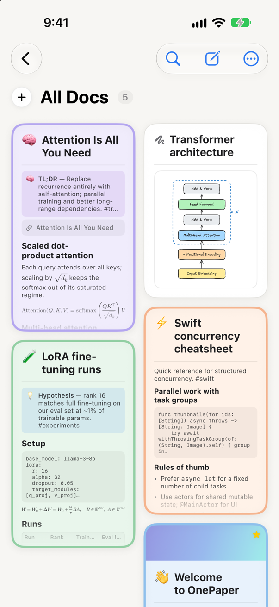
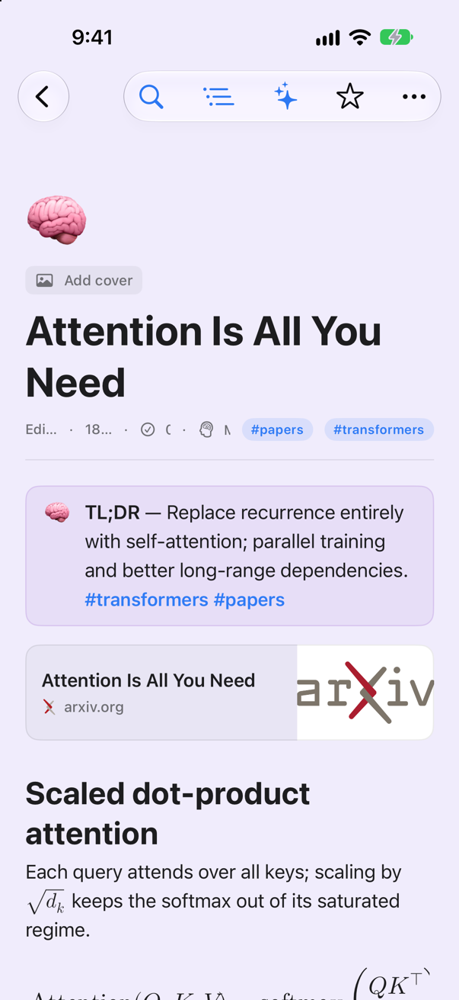
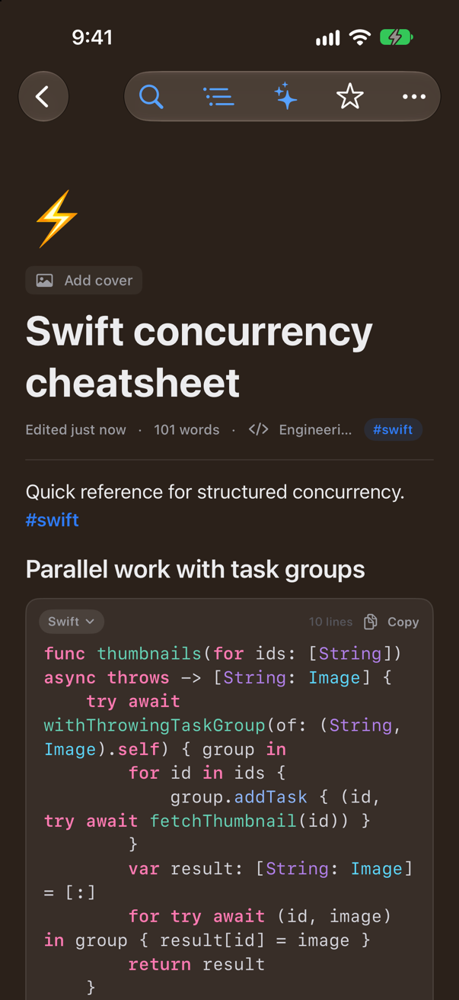

<h1 align="center">OnePaper</h1>

<p align="center">
  <b>Beautiful notes for engineers.</b><br>
  A Craft-style block editor for Mac, iPad and iPhone, made for code, math, experiments and
  whiteboards, and synced through iCloud.
</p>

<p align="center">
  <a href="https://github.com/jhasubhash/onepaper-releases/releases/latest">
    </a>
  
  
  
  
</p>

<p align="center">
  <a href="https://www.buymeacoffee.com/subhashjha"></a>
</p>

<p align="center">
  
</p>

<p align="center">
  <a href="https://github.com/jhasubhash/onepaper-releases/releases/latest"><b>Download for Mac</b></a>
  &nbsp;·&nbsp; iPhone and iPad via TestFlight
</p>

OnePaper is a native SwiftUI notes app with everything an engineer's notes need built in:
syntax-highlighted code, LaTeX math, tables, databases and hand-drawn whiteboards. It looks like
Craft and feels like a Mac app. Every page is a sheet in its own colour, your library is a wall of
live previews, and it all syncs privately through your own iCloud.

---

## ✍️ A block editor that keeps up with you

<p align="center">
  
</p>

- **Every block you need:** text, headings, lists, to-dos, toggles, quotes, callouts, dividers,
  images and nested pages. Type `/` for any of them.
- **Markdown as you type:** `# `, `- `, `[] `, `> ` and ```` ``` ```` turn into blocks, and
  `**bold**`, `` `code` ``, `==highlight==`, `$math$` and `#tags` style inline. The markers hide
  when you leave the line.
- **Linked thinking:** `[[Page]]` links with autocomplete, plus backlinks on every page.
- **Links your way:** paste a link as plain text, a bookmark card or an **embed**. YouTube, Vimeo,
  Loom, Spotify and Figma play right in the page.

## 🧪 Made for code and ML

<p align="center">
  
</p>

| | |
| --- | --- |
| 💻 **Code** | Syntax highlighting for 20 languages, including Python, Swift, Rust, Go, C++, CUDA, SQL and YAML, with smart indent and a copy button |
| ∑ **Math** | LaTeX display blocks and inline `$…$` formulas, rendered natively |
| 📊 **Tables & Collections** | Quick tables for results, plus databases with typed properties and Table, Board, Gallery and List views |
| 📄 **Templates** | Paper notes, experiment log, TIL, bug investigation, design doc, meeting and interview prep |
| 🔗 **Link previews** | arXiv, GitHub and docs links become rich cards |

## 🎨 Whiteboards

<p align="center">
  
</p>

A full **Excalidraw** canvas, bundled and working offline: shapes, arrows, freehand and Apple
Pencil, with hand-drawn fonts. Whiteboards are pages too. They live in folders, show up in search,
and can be embedded in a page with `/whiteboard`. Export as PNG, SVG or `.excalidraw`.

## ✅ Tasks, wherever you wrote them

<p align="center">
  
</p>

- **One Tasks view** gathers every to-do from every page: **Inbox** for quick captures, Today
  (with overdue), Upcoming, All and Done.
- **Dates the way you'd say them:** type `@` in a to-do (`@tomorrow 9am`, `@next fri`), or add
  "review PR tomorrow 10am" from the Tasks view.
- **Reminders that sync:** OnePaper notifications, **Apple Reminders** (two-way) or **Todoist**,
  plus "Send to Things 3".

## 🌗 Light, dark and everything in between

<p align="center">
  
  
</p>

13 page colours (Paper, Rose, Mint, Sky, Lavender, Notebook dot grid, Blueprint, Midnight,
Terminal and more), Sans, Serif, Rounded and Mono fonts, covers, and 9 accent colours. Light,
dark or system appearance.

## 📱 On iPhone and iPad

<p align="center">
  
  &nbsp;
  
  &nbsp;
  
</p>

The same notes, pages and whiteboards everywhere, synced through your iCloud account. Nothing
goes through a server of mine.

## 🗂️ And also

- **Spaces** (Work, Research, Personal…), each with its own pages, folders, tags and tasks. Press ⌃1…⌃9 to switch.
- **Tabs** that open pages side by side. Show them at the top, auto-hidden, or in the sidebar.
- **Calendar** with daily notes.
- **⌘K quick open** with full-text search.
- **AI writing with Claude:** continue, summarize, fix grammar, explain code, convert to LaTeX, or ask your notes.
- **Export** as Markdown, HTML or PDF, and import Markdown.

---

## Install

### Mac

1. Download `OnePaper-x.y.z.dmg` from **[Releases](https://github.com/jhasubhash/onepaper-releases/releases/latest)**.
2. Open it and drag **OnePaper** to **Applications**.

Builds are signed with Developer ID and notarized by Apple. OnePaper updates itself: it checks in
the background, or use **OnePaper › Check for Updates…**. Requires macOS 26 or later.

### iPhone and iPad

OnePaper is in beta on **TestFlight**. Requires iOS and iPadOS 26 or later.

## Support

If OnePaper makes your notes a nicer place to think, you can
[buy me a coffee](https://www.buymeacoffee.com/subhashjha) ☕

---

<sub>This repository hosts the downloads and the update feed. `appcast.xml` is the
[Sparkle](https://sparkle-project.org) feed the Mac app reads, and every update is EdDSA-signed.
Release notes are on each [release](https://github.com/jhasubhash/onepaper-releases/releases).</sub>
